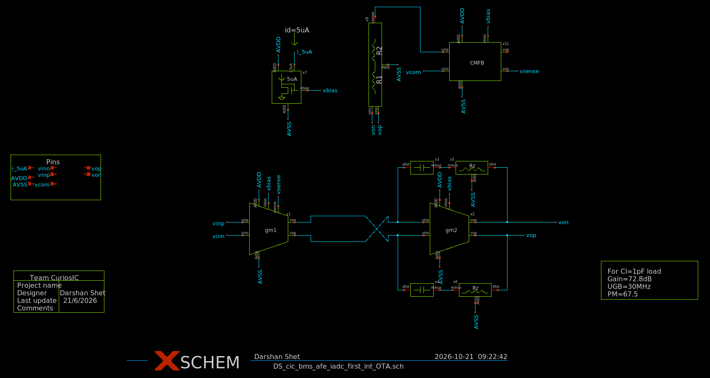
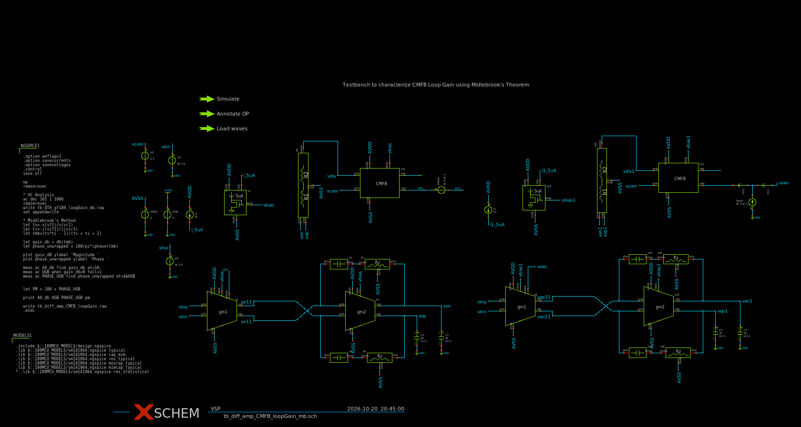
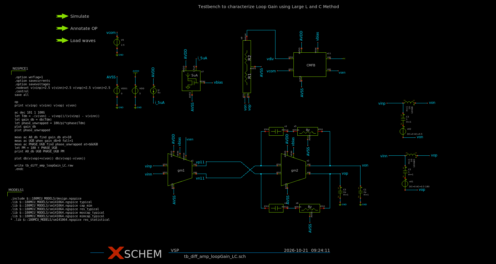

# Fully differential opamp: testbenches

Two testbenches for the fully differential opamp, built in Xschem and simulated with ngspice on the GF180MCU PDK.

| Testbench | What it measures | Method |
|-----------|------------------|--------|
| `tb_diff_amp_CMFB_loopGain_mb.sch` | Common-mode feedback (CMFB) loop gain | Middlebrook (voltage + current injection) |
| `tb_diff_amp_loopGain_LC.sch` | Differential loop gain, unity feedback | Large L / large C loop break |

All schematics and symbols are in `xschem/`. Start Xschem from that folder so the symbols resolve.

## The opamp (simplified)

* **First stage:** NMOS differential pair (inputs `vinp`, `vinn`) with PMOS loads. The load gates are the CMFB control node (`vsen` / `vsense`).
* **Second stage:** common-source stage per side, with Miller compensation (capacitor plus nulling resistor).
* **CMFB:** resistive divider from `vop` / `von` to `vdiv`. A differential pair compares `vdiv` with `vcom` (2.5 V) and drives the first-stage load gates through a diode-connected PMOS load.
* **Bias:** 5 uA reference current into a mirror. Each output has a 2 pF load.

Polarity: `vinp` is non-inverting for `vop`, and `vinn` is non-inverting for `von`. Negative differential feedback therefore goes `von -> vinp` and `vop -> vinn`. The CMFB loop is negative feedback.



## Conventions

Break the loop at one node. `X` is the side that returns the signal and `Y` is the side that drives the next stage. The loop gain is output side over input side, with a minus sign, so a negative-feedback loop has a positive `T` that starts at 0 degrees:

$$T = -\frac{v_X}{v_Y}$$

Phase margin is `PM = 180 deg + phase at the 0 dB crossing`. The control blocks measure `A0` at 10 Hz, the unity-gain frequency (`UGB`), the phase at `UGB`, and `PM`. The AC sweep runs from 1 Hz to 100 GHz, 101 points per decade.

## 1. CMFB loop gain, Middlebrook method

**File:** `tb_diff_amp_CMFB_loopGain_mb.sch`



### Setup

The opamp is instantiated twice. The two copies share only ideal sources (supplies, inputs, `vcom`), so voltage and current injection run in a single `.ac` analysis without interacting.

* **Main copy, voltage injection:** `Vtest2 vf1 vr1 dc 0 ac 1` is in series between the CMFB output `vf1` (X) and the first-stage load-gate node `vr1` (Y).
* **Replica copy, current injection:** `Itest1 GND net8 dc 0 ac 1` injects current into `net8`, between two 0 V current probes: `Vir1 vsen net8 0` (towards the load gates) and `Vif1 net8 net6 0` (towards the CMFB output).
* **DC:** the loop is closed through the 0 V sources, so `.op` gives the true closed-loop bias point.
* Inputs `vinp` / `vinn` and the CMFB reference `vcom` are at 2.5 V DC.

### Loop-gain expressions

```
let tv  = -v(vf1)/v(vr1)
let ti  = -i(vif1)/i(vir1)
let tmb = (tv*ti - 1)/(tv + ti + 2)
```

$$T_v = -\frac{v(vf1)}{v(vr1)},\qquad T_i = -\frac{i(vif1)}{i(vir1)},\qquad T = \frac{T_v T_i - 1}{T_v + T_i + 2}$$

`Tv` is accurate while the impedance looking back into the CMFB output is much smaller than the gate impedance, which holds at low frequency. `Ti` corrects the result near the high-frequency poles, where the gate capacitance matters.

### Results

| A0 | UGB | Phase at UGB | Phase margin |
|----|-----|--------------|--------------|
| 84.8 dB | 28.9 MHz | -171.5 deg | **8.5 deg** |

The phase margin is too low and needs to be improved. Candidates: reduce the CMFB loop gain by about 15 dB so the crossover moves into the -90 deg plateau, or add a dominant pole at the CMFB output.

### Notes

* An earlier version of the expressions had both ratios inverted (`-v(vr1)/v(vf1)` and `-i(vir1)/i(vif1)`). That gives `tmb = -0.5` at low frequency, a flat -6 dB at 180 deg. The expressions above are the corrected ones.
* A result of about -6 dB flat with a 180 deg phase is the symptom to look for if the ratios are ever swapped again.

## 2. Differential loop gain, large L / large C method

**File:** `tb_diff_amp_loopGain_LC.sch`



### Setup

Unity feedback: each output returns to the opposite input. The loop is broken at the opamp inputs with the same structure on both paths, using opposite-sign AC sources so the excitation is purely differential. The CMFB loop stays closed.

```
* p path: X = von, Y = vinp
Lbp vinp von 1G
Cbp von  nbp 1
Vtp nbp  vinp dc 0 ac 0.5

* n path: X = vop, Y = vinn
Lbn vinn vop 1G
Cbn vop  nbn 1
Vtn nbn  vinn dc 0 ac 0.5 180
```

* **DC:** the 1 GH inductors short each output to its input, so the bias point is the real closed-loop one. The 1 F capacitors are open.
* **AC:** the capacitors are shorts and the inductors are open. Each path is then a series voltage injection with `V(X) - V(Y) = +-0.5`, which adds up to 1 V differential. The L/C resonance is near 5 uHz, far below the 1 Hz sweep start.
* **Operating point:** there are no DC sources on `vinp` / `vinn`. Unity feedback alone does not set the input level, and ngspice can settle in a dead solution with every node at 0 V. A `.nodeset` on `vinp`, `vinn`, `vop` and `von` (2.5 V) selects the correct operating point. Check it with `print v(vinp) v(vinn) v(vop) v(von)` before trusting the AC result.

### Loop-gain expression

```
let Tdm = -(v(von) - v(vop)) / (v(vinp) - v(vinn))
```

This is output side over input side, with a minus sign. With unity feedback `T = A(s)`, the opamp's differential gain.

### Results

| Operating point | A0 | UGB | Phase at UGB | Phase margin |
|-----------------|----|-----|--------------|--------------|
| `vinp`, `vinn`, `vop`, `von` all at 2.504 V | 62.3 dB | 38.8 MHz | -125.3 deg | **54.7 deg** |

Checks:

* **Purely differential excitation:** `db(v(vop)+v(von))` is at least 60 dB below `db(v(vop)-v(von))` over the whole sweep. The common-mode leakage near -280 dB at low frequency is the numerical floor, because the circuit is perfectly symmetric.
* **High-frequency floor:** the gain levels out near -37 dB with a notch around 1 GHz. This is capacitive feedthrough around the amplifier and does not affect stability.

### Notes

* This is a voltage-injection measurement (`Tv` only), with no current-injection correction. It is accurate while the output impedance at the break is small compared with the gate impedance. Compare against a Middlebrook measurement if the crossover moves into the tens of MHz and accuracy matters.
* Unity feedback is the worst case for phase margin. With the real feedback network (beta < 1) the crossover is lower and the margin is usually larger.

## How to run

1. `cd fully_diff_opamp/xschem` and start `xschem`.
2. Open a testbench and press **Netlist**, then **Simulate**. The control block runs `op` and `ac`, prints `A0_db`, `UGB`, `PHASE_UGB` and `pm` in the ngspice console, and plots magnitude and phase.
3. The control block also writes a `.raw` file. Raw files are not committed (see `.gitignore`).

## Status and next steps

* [x] CMFB loop gain (Middlebrook)
* [x] Differential loop gain, unity feedback (L/C)
* [ ] Improve CMFB phase margin (currently 8.5 deg)
* [ ] Differential loop gain with the real feedback network
* [ ] Corners and temperature
* [ ] CMRR (needs mismatch, for example Monte Carlo, because the nominal circuit is symmetric)
